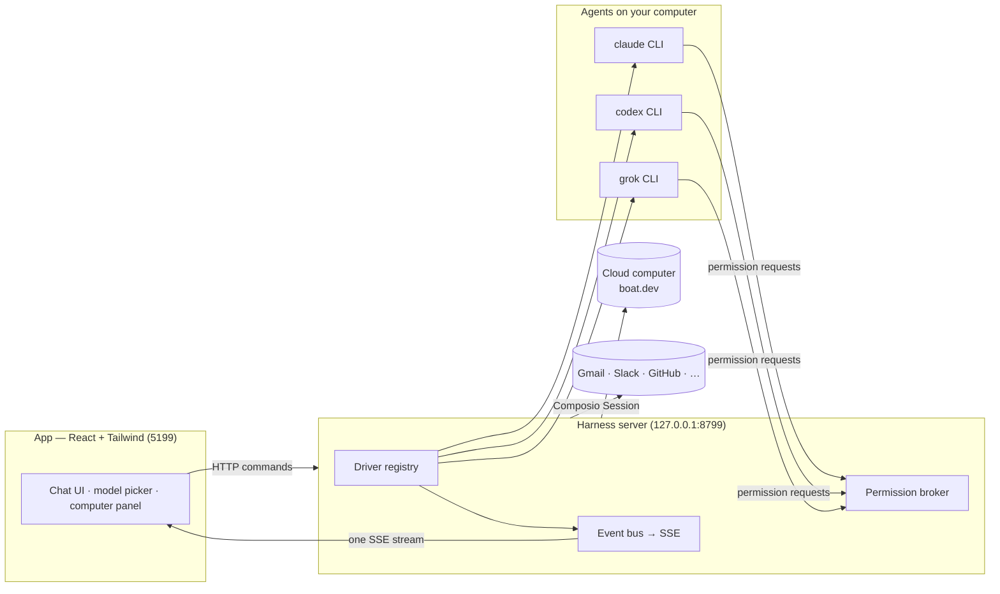

<div align="center">

# OpenBot

**本地优先的 AI 智能体团队桌面应用。**

侧边栏里的每个 bot 都是一个真实运行的 agent —— 各自有性格、自己的模型、自己的工作空间。
像联系人一样和它们对话，看它们干活，审批重要操作。


</div>

> 本项目是 [OpenMausBot](https://github.com/milind-soni/OpenMausBot)（Apache-2.0）的改造版：
> 品牌、包标识与图标已替换为 OpenBot，核心能力来自上游项目。
> 原项目的版权与归属声明保留在 [NOTICE](NOTICE)。

> 此仓库仍保留部分上游文档引用；部分链接指向的文件尚未包含在当前仓库中。
> Several links below refer to upstream documentation not yet included in this fork.

> [!IMPORTANT]
> **设计核心原则**：
> 1. **严禁任何收费/充值按钮**：全应用不包含任何收费入口、额度购买、自动扣费或商业化支付按钮，完全由用户自带 API Key / 本地 CLI 运行，保险库仅用于管理本地网站登录凭据。
> 2. **个人云电脑 (Local VM) 架构**：
>    - **macOS**：采用 **Docker** 容器方案提供独立的 Linux 沙箱环境（无头 Chromium、Xvfb 与 CUA 操作驱动）。
>    - **Windows**：采用 **WSL2**（Windows Subsystem for Linux 2）/ **Docker Desktop WSL2 引擎** 作为容器底座，无缝运行 Linux 隔离沙箱；同时支持 Windows 原生 CUA 桌面托管模式。


## Why

One assistant in one box is the wrong shape for agents. OpenBot is an independent, open-source project inspired by **Grok Bot** —
it keeps the idea (AI as a *messaging app*: a roster of bots you chat with, each with its own personality,
memory of its thread, model, computer, and apps) and rebuilds it open, local-first, and on the agents you
already have:

- **Bring your own agents.** Bots run on the `claude`, `codex`, and `grok` CLIs installed on your own machine
  — your existing logins and subscriptions, no new accounts, no proxy in the middle. Point any engine at a
  custom CLI binary (a versioned build or wrapper) in **Settings → Engines**.
- **Local first.** One small harness server on `127.0.0.1` owns every agent process. Transcripts, keys, and
  events live in `~/.openbot`, not a cloud.
- **Agents with hands.** Each bot can use a cloud Linux desktop, an isolated Local VM, or—where the platform
  safety boundary is currently certified—your own computer, plus 500+ apps through Composio. Host control is
  available on macOS and Ubuntu Xorg after explicit opt-in. Ubuntu Wayland host control remains disabled while
  issue #345 is resolved.

## The open-source alternative to Grok Bot, Muse, dots and Cue

Four closed personal-agent products shipped in seven weeks of 2026, and each one keeps the model, the
computer and your data on its maker's side of the line. OpenBot is the open-source version of that
shape: a team of agents in a chat app, each with its own model, its own computer and its own connected
apps, running on your machine under Apache 2.0. If you searched for an *open Muse*, *open dots*, an
*open-source Grok Bot*, an *open Instinct* or an *open Cue*, this is the repository.

| Looking for | What it is | How OpenBot differs | Read more |
| --- | --- | --- | --- |
| **Open source Grok Bot** | xAI's roster of bots on one shared cloud computer, Grok only, from a SuperGrok or Cursor plan | Same roster shape; any model per bot; your own machine; approval cards | [Grok Bot vs OpenBot](https://www.openbot.com/blog/grok-bot-vs-openbot) |
| **Open Muse** | Meta's single personal agent in a Meta cloud VM, US and Canada only | A team instead of one agent; runs anywhere; data in `~/.openbot` | [Meta Muse alternative](https://www.openbot.com/blog/open-source-alternative-to-meta-muse) |
| **Open dots** | OpenAI's always-on agent inside ChatGPT, GPT only, Pro and Business Premium plans | Several agents; your Claude, ChatGPT or Grok login; no plan required | [OpenAI dots alternative](https://www.openbot.com/blog/openai-dots-alternative) |
| **Open Cue** | Manus's invite-only agents with their own phone, email and wallet | No invite; OAuth instead of passwords; open source | [Cue by Manus alternative](https://www.openbot.com/blog/open-source-alternative-to-cue-by-manus) |
| **Open Instinct** | Spear Street's invite-only agent that holds your passwords on a cloud computer | Ask for approval when you want it; signs in over OAuth; your machine | [Instinct AI alternative](https://www.openbot.com/blog/instinct-ai-alternative) |

All five side by side: [Muse vs Grok Bot vs Dots vs Cue](https://www.openbot.com/blog/muse-vs-grok-bot-vs-dots-vs-cue),
and a decision guide in five questions: [Which AI agent should I use?](https://www.openbot.com/blog/which-ai-agent-should-i-use)

## Features

<table>
<tr>
<td width="50%" valign="top">

### 🧠 Pick a brain per bot

A model picker with a provider rail — Claude and Codex models side by side, defaults marked, unavailable
providers dimmed with the reason. Switch a bot's model mid-conversation.


</td>
<td width="50%" valign="top">

### 🖥️ Every bot gets a computer

Open the Computer panel and the bot's cloud desktop spins up on its own — live screen preview while it
works, "Open desktop" to take over in your browser, or point the bot at *this Mac* instead.


</td>
</tr>
<tr>
<td width="50%" valign="top">

### 🙋 Bots ask before they act

Shell commands, file edits, and questions surface as inline cards — Allow / Deny / answer in chat. A
permission broker turns every risky action into a decision you make, for cloud and local computers alike.


</td>
<td width="50%" valign="top">

### 🔌 Connected apps

A one-click marketplace over Composio Sessions: Gmail, Slack, GitHub, Notion, Linear and hundreds more.
OAuth once, and every bot can use them as tools.


</td>
</tr>
<tr>
<td width="50%" valign="top">

### 🗂 Manage bots like chats

Right-click any bot: pin, mark unread, edit profile, duplicate, copy conversation ID, hide, delete. It's a
messaging app — your agents behave like contacts.


</td>
<td width="50%" valign="top">

### 🔑 Keys once, everything lights up

Paste credentials in App Settings — they persist locally and the provider fleet hot-reloads instantly.
Secrets are write-only: the UI only ever sees "configured" flags.


</td>
</tr>
</table>

### #️⃣ Channels for every context

Keep Work, Personal, and each project in separate channels without cloning your bots. Every channel has
its own transcript, shared instructions, working folder, responder rules, and editable bot roster. File a
channel and its bots under a named context, then rename it or change its members whenever the team changes.

### ⚡ Fast decisions with Jev

Add a TypeSafe Jev key, or an OpenRouter key and model, in **Settings → Decision model** and rooms set to **Auto** pick the bot
that fits each un-mentioned message in a few hundred milliseconds, falling back to the room's lead whenever the decision model is off or unsure.
See [docs/decision-model.md](docs/decision-model.md).

### 📦 Install a complete team from one Markdown file

Browse outcome-driven teams on [BotMRR](https://botmrr.io), then choose **Add to OpenBot**. The app
opens a review screen before creating the bots, Chief of Staff, channels, playbooks, connector checklist,
and suggested routines. You can also import the same `.md` file from disk or paste its public GitHub URL
in **Teams → Import**.

The format stays portable: OpenBot reads the structured YAML frontmatter for a reliable one-click
install, while Grok, Claude, ChatGPT, and people can follow the ordinary Markdown playbook. Connections
remain off until you approve them, routines arrive paused, and packages never carry credentials,
conversations, permissions, memory, or computer access. Browse the
[open-source playbook repository](https://github.com/milind-soni/openbot-teams) or read its
[portable format](https://github.com/milind-soni/openbot-teams/blob/main/FORMAT.md).

### 🤝 Share a whole department

Right-click a department and choose **Share department…** (or use **Templates → Share**) to save the whole department as one
file: its bots with their instructions, pictures and skills, group chats, routines, shared instructions,
Chief of Staff, connection slots and each bot's starter notes (untick them to leave them out). The dialog
shows exactly what the file holds before you save it. Chat history, keys and passwords, model choices and
computers never go in, and anything that looks like a secret is removed from the text. Whoever imports it
gets new bots on Ask, skills switched off and routines paused. See [docs/team-sharing.md](docs/team-sharing.md).
Desktops connected to an organization also get **Templates → From {Organization}**: the packages its Admin shares,
added with one click, skills switched on. See [docs/org-library.md](docs/org-library.md).
Your New bot defaults can travel too, as a **preset bot** that appears in New bot (in a team file, or on
their own with **Share as preset…**). See [docs/presets.md](docs/presets.md).

### 🎧 Bots that talk back

Press the speaker on any reply, or switch a bot to read its answers out as they land — so you can listen
to what ran overnight while you make breakfast. Hit **call** and it's a conversation: it hears you, tells
you what it's doing while it works, and asks for approvals out loud.

Choose ElevenLabs, Fish Audio, Grok (xAI), built-in Mac voices, or a local Chatterbox server in an agent profile. Paste a
cloud key once when needed, pick a voice, and every bot can talk.
Give a bot its own voice and a channel stops sounding like one person.

For Grok, save your xAI API key in **Settings → Connections**, then choose **Grok (xAI)**
and a voice under the bot’s **Voice & alerts**. It reuses that host-side key and returns MP3
audio for spoken replies and calls. Language is detected automatically from the reply text;
quality varies outside xAI’s [officially supported languages](https://docs.x.ai/developers/model-capabilities/audio/text-to-speech).
This adds speech synthesis to the existing call flow; microphone transcription remains unchanged.

**Also in the box:** streaming replies with tool-run activity chips · dictation from the
composer mic (on-device Apple speech recognition on macOS, Fish Audio speech-to-text on Windows and Linux, in the desktop app) · SupaMaus cursor mascots with role-aware
expressions · screenshots of the bot's work folded into the transcript.

## Powered By

<div align="center">


</div>

| Service | Purpose |
|---|---|
| **Claude · Codex · Grok** | The agents behind every bot, run through their local CLIs |
| **Electron** | Desktop shells for macOS, Windows, and Ubuntu |
| **React + Vite + Tailwind CSS** | The chat app UI and its build |
| **Boat** ([boat.dev](https://boat.dev)) | Each bot's cloud computer · our sponsor |
| **Composio** | Connected apps — Gmail, Slack, GitHub, and more |
| **Cua Driver** | Native computer use on your own machine |
| **ElevenLabs · Fish Audio** | Hosted voices for bots that talk back |
| **GitHub Sponsors** | One-time and monthly project support |

## How it works

Two processes. The app holds no transports of its own — it sends typed commands over HTTP and folds one SSE
event stream into state. The harness server owns every agent process and normalizes each provider's native
protocol into one canonical runtime event stream (logged per-thread as NDJSON).



| Layer | Where | What it does |
|---|---|---|
| Drivers | `server/drivers/` | One per provider: Claude, Codex, and Grok Build over their local CLIs (stream-JSON / JSON-RPC / ACP), plus a cloud-computer agent. Unknown drivers degrade to "unavailable", never crash the fleet. |
| Harness | `server/harness/` | Registry (configs → live instances) and the fan-in event bus every client folds. |
| API | `server/index.ts` | Bots, turns, approvals, model catalog, computer lifecycle, connectors, config — HTTP + SSE. |
| Voice | `server/tts/` | ElevenLabs, Fish Audio, Grok (xAI), built-in Mac voices, or local Chatterbox. Cloud keys stay on the harness; markdown is rewritten into something worth hearing before it is spoken. |
| App | `src/` | The chat shell. Server-backed store, one reducer, zero client-side transports. |
| Desktop | `electron/` | macOS, Windows, and Ubuntu shells with an embedded harness and platform capabilities; Apple speech stays macOS-only, Ubuntu Xorg has opt-in local control, and Wayland remains fail-closed. |

### Orchestrate OpenBot over MCP

OpenBot ships a stdio MCP server for external clients such as Claude Desktop and Cursor. It exposes a
deliberately bounded team control plane: inspect bots and channels, read/search compact transcript pages,
create and configure bots/channels/tasks, send work, wait for completion, switch models, and interrupt turns.
It does **not** expose approval grants, deletion, arbitrary settings, credentials, or computer lifecycle.

See [MCP server setup and tool reference](docs/mcp-server.md).

### Run it from scripts and CI

The `openbot` command drives a running workspace without a screen: set a
team up from a file, give a bot one job, wait until it and every teammate it
asked are done, and export what they made. One JSON document with `--json`,
and exit codes a script can branch on.

```sh
pnpm omb team apply team.yaml
pnpm omb run "Room Lead" "Rehearse the launch of https://example.com" --export ./out
```

See [Run OpenBot from scripts and CI](docs/headless-cli.md).

## Quick start

This fork has no published releases as of 2026-11-12. Build and run it from source;
the upstream project's installers are not builds of this repository.

```sh
git clone https://github.com/lqq151510/open-bot.git && cd open-bot
pnpm install

pnpm dev:server    # harness server → 127.0.0.1:8799
pnpm dev           # app → http://127.0.0.1:5199
pnpm dev:desktop   # Electron shell; keep the two commands above running
```

Requirements: **macOS, Windows, or Ubuntu 24.04 x64**, **Node 24+**, **pnpm**, and at least one agent CLI — [`claude`](https://claude.com/claude-code),
[`codex`](https://github.com/openai/codex), or [`grok`](https://x.ai/cli) — installed and logged in. They appear
in the model picker automatically.

Package the desktop application:

```sh
pnpm package:mac      # macOS: DMG + ZIP; requires Swift/Xcode tools
pnpm package:win      # Windows: installer + ZIP
pnpm package:linux    # Ubuntu x64: .deb + AppImage
```

These packaging scripts have not been verified for this fork's current revision. The full `pnpm test`
command also depends on a broker test configuration absent from this checkout; run targeted tests and
report their results separately. The cloud-home Docker build references missing `deploy/fly` files.

### Desktop capability status

| Capability | macOS | Ubuntu 24.04 Xorg | Ubuntu 24.04 Wayland |
|---|---|---|---|
| Packaged app, embedded harness, local agent CLIs | Supported | Beta | Beta |
| Composio and Boat/cloud computers | Supported | Beta | Beta |
| Explicit preview-only local screen capture | Supported | Beta | Beta |
| Bot control of this computer | Supported | Beta, explicit opt-in | Disabled: Wayland safety gate (Omarchy with Cua's Hyprland plugin: experimental) |
| Native on-device dictation | Supported | Planned | Planned |
| Dictation and Take turns calls through Fish Audio (needs a Fish Audio key) | Not used, on-device instead | Supported | Supported |

The Linux preview is user-initiated and never enables local bot control or Auto routing. On Xorg, the reviewed Cua
Driver 0.41.3 runtime starts only after explicit opt-in and without its full-screen cursor overlay. On Wayland the
app never starts it and clears legacy opt-ins while that real-seat safety gate remains unresolved. Chat, preview,
Cloud, and Local VM remain available on both sessions. See the [Ubuntu Desktop guide](docs/linux-desktop.md) and tracking
issues [#29](https://github.com/milind-soni/OpenBot/issues/29),
[#345](https://github.com/milind-soni/OpenBot/issues/345), and
[#113](https://github.com/milind-soni/OpenBot/issues/113).

The Linux packager downloads only the tag-pinned upstream archive during the build, verifies its size, SHA-256,
complete member allowlist, and inner executable hashes, then packages only the CLI and cursor-theme sidecar. The
installed app never downloads or self-updates native automation code. Cua's MIT notice, Inter's SIL OFL, a generated
third-party license report, and a CycloneDX inventory ship with the runtime. See
[`third_party/cua-driver/`](third_party/cua-driver/) for the reviewed provenance record.

These credentials are optional — local chat works without them. Paste a key once in **App Settings** (gear
in the sidebar footer) when you want to enable its integration:

| Credential | What it enables | Where to get it |
|---|---|---|
| Composio project key (`ak_…`) | Connect Gmail, GitHub, Slack, Notion, and other apps to your bots | [OpenBot Composio setup](docs/composio.md) |
| Boat API key | Give bots an isolated remote Linux computer with a desktop and terminal | [Boat API key guide](https://docs.boat.dev/api-keys) |
| ElevenLabs key | Read replies aloud, and call your bots | [ElevenLabs API keys](https://elevenlabs.io/app/settings/api-keys) |
| Fish Audio key | Read replies aloud with Fish Audio voices, and call your bots | [Fish Audio API keys](https://fish.audio/app/api-keys/) |

Composio and Boat are third-party services with their own accounts and terms. Boat is a paid service after
its trial, and using a cloud computer may incur charges.

```sh
pnpm typecheck     # app + server
pnpm test          # unit, driver, API, and desktop capability tests
pnpm build         # typecheck + production build
pnpm check:electron # syntax-check Electron main/preload files
pnpm package:win   # Windows installer + zip → release/
pnpm package:linux # Ubuntu x64 .deb + AppImage → release/
```

### Triggers: schedules and webhooks

A trigger is "when something happens, a bot does something". Tell a bot "every weekday at 9, send me a summary
of my inbox" or "whenever our form calls, draft a reply" and it sets the trigger up in that turn with
its `trigger` tool (no confirmation; the chat shows a live card with Edit, Pause and Undo). **Triggers**, first in
the sidebar, lists every schedule and webhook, with a calendar and the run history. Bots manage them with
`trigger_info` (list, app events), `trigger` (create, update, pause, resume, run now) and `delete_trigger`; a webhook a bot makes never shows the bot its secret:
the person copies the link from the card or the Triggers page.

Schedules (routines) can run once, on selected weekdays, or every 5–1,440 minutes, using either a bot's configured
model/computer or the Cloud VM runner. Interval schedules stay aligned to their chosen start time and skip
an occurrence when the previous run is still active, so slow work cannot build an unbounded queue. A
separate optional Advanced run limit can safely stop stuck work; no timeout is imposed unless one is chosen.
The existing duration field remains calendar/display metadata. Webhook triggers are independent from schedules
but reuse the same queued task executor and calendar
receipts.

**App events** start a bot when something happens in a connected app ("whenever I get an email from Acme, draft
a reply"). The bot finds the app's events with `trigger_info` (`action: "events"`) and calls `trigger` with
`action: "create"` and `when: "app_event"`; the person can also choose **New → Set it up yourself → When something happens in an app**.
Composio sends each event to OpenBot's connected-apps service, which queues it; the app collects the queue
with a long poll, so a desktop needs no public address and events wait while it is closed. Gmail is checked every
15 minutes; Slack, GitHub and other push apps arrive at once. A desktop keeps up to 500 events a day and a paid
Cloud 2,000; what is skipped shows on the automation. App events need the included connected apps: a server
using its own Composio key cannot watch apps yet. Details: [docs/composio.md](docs/composio.md#app-events).

OpenBot starts a webhook-only receiver on `127.0.0.1:8800` by default (or one port above `OMB_PORT`).
Set `OMB_WEBHOOK_PORT` to choose another port. A webhook secret is shown once when the trigger is created
or rotated. Bearer authentication is recommended so the secret stays out of request URLs and most access
logs; a single capability URL remains available for senders that cannot configure headers. The receiver
exposes only `/health` and secret `/hooks/...` endpoints; it never exposes the app's broader API.
OpenBot must remain running to accept a delivery. For public internet delivery, proxy only this
dedicated receiver through a hosted relay or a tool such as Tailscale Funnel.

## Status

Early but real — the loop works end to end: message → agent → streamed reply → tools → approvals →
computer use. macOS, Windows, and Ubuntu 24.04 x64 have released builds; Ubuntu remains a beta with the
capability limits above. Rough edges to expect: hosted/mobile connectivity is still being built, and webhook
triggers currently use the local receiver rather than an always-on hosted relay.
Hosted voice needs an ElevenLabs, Fish Audio, or xAI key; built-in Mac and local Chatterbox voices need no cloud key. Take-turns calls and the composer mic listen on-device on macOS and through Fish Audio speech-to-text on Windows and Linux (the same Fish Audio key as voices). See [`docs/voice-mode.md`](docs/voice-mode.md) for the design and the known gaps.

Contributions welcome — the driver SPI in [`server/contracts.ts`](server/contracts.ts) is deliberately
small; adding a provider is one file in [`server/drivers/`](server/drivers/) plus a one-line registration.
No code needed at all for your own engines: any ACP-speaking CLI or OpenAI-compatible endpoint
plugs in through config — see [`docs/custom-engines.md`](docs/custom-engines.md).
Users can add their own MCP tool servers with zero code via [`docs/custom-mcp-servers.md`](docs/custom-mcp-servers.md).
To run bots on OpenRouter, Fireworks AI, DeepSeek, Cline or your own OpenAI- or Anthropic-compatible provider,
see [Other model providers](apps/docs/content/docs/providers/model-providers.mdx).

## Privacy

Usage analytics are optional and anonymous: product events and a once-a-day count of what is set up, never keys,
names, addresses or conversations. Turn them off in Settings → General → Usage analytics;
[`docs/analytics.md`](docs/analytics.md) lists every event and property.

## Run from a terminal or on a server

With Node 24 or newer, run the CLI from this repository after `pnpm install`:

```sh
pnpm omb
```

First launch guides you with
arrow-key choices: choose AI access, sign in or paste a hidden API key, choose
a model, and optionally connect a phone. Next time, the same command reuses your
saved setup and opens OpenBot on this computer. Keep the terminal open; Ctrl-C stops
the server, not your saved work. Use `--no-open` to skip opening the browser.

Phone access is optional and defaults to skipping. Choose an explicitly
approved managed public HTTPS endpoint protected by pairing, an existing
Tailscale connection, or your own HTTPS reverse proxy. Both native apps pair from
this flow: the QR is an app link when you are connecting an Android phone, and the
iOS app takes either that or the web link. A browser works on either phone. A phone
cannot use a localhost link. `--local` ignores saved remote access for one launch;
`--no-pair` suppresses phone prompts and invitations but does not disable a saved
remote connection.

The web UI can also be installed from Safari or Chrome as a standalone phone
app. See [Install the phone web app](docs/phone-web-app.md) for Home Screen
installation and pairing.

Run `pnpm omb setup` to reconfigure without resetting bots or conversations;
the saved model default applies only to new bots. Native setup confirms provider
sign-in; API setup asks before a potentially billable test message. API keys are
saved as plaintext, not encrypted, in private `config.json` (`0600` on Unix).
See the [short setup guide](docs/cli-onboarding.md) for account differences,
phone choices, credential storage, and cancellation.

Hosted deployment for this fork needs separate verification. The cloud-home Docker stage currently
references `deploy/fly` configuration that is not present in this checkout; do not treat the upstream
deployment instructions as a verified deployment for this fork.

## License

The repository includes the [Apache License 2.0](LICENSE) and retains upstream attribution in
[NOTICE](NOTICE). Bundled third-party components retain their respective licenses. The inherited
[LICENSING.md](LICENSING.md) also describes an upstream `enterprise/` directory that is not present
in this checkout.

Packaged Cua Driver components retain their upstream MIT, SIL OFL 1.1, MPL-2.0, and other dependency terms;
the corresponding notices, license texts, source locations, and SBOM are in
[`third_party/cua-driver/`](third_party/cua-driver/) and ship beside the native runtime.

OpenBot is an independent, open-source project inspired by Grok Bot. It is
not affiliated with, endorsed by, or associated with xAI; "Grok" is a trademark
of its respective owner.
